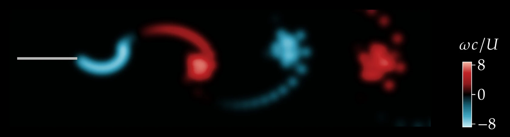

# Unsteady vortex panel solver

<p align="center">
  <a href="https://github.com/EngFlavioMartins/unsteady-vortex-source-solver/actions/workflows/tests.yml"></a>
  <a href="https://www.python.org/"></a>
  <a href="https://github.com/EngFlavioMartins/unsteady-vortex-source-solver/blob/HEAD/LICENSE"></a>
</p>

**Pitching and plunging airfoils and the wakes they shed, with an unsteady vortex panel method.**

<p align="center"></p>

The airfoil is a row of vortex panels; at every time step the solver enforces no flow through the panels and Kelvin's theorem, sheds a vortex from the trailing edge and lets the whole wake roll up freely. It runs a thousand time steps in about two seconds. The derivation is in [Resources/Report.pdf](Resources/Report.pdf).

## Run it

```bash
git clone https://github.com/EngFlavioMartins/unsteady-vortex-source-solver.git
cd unsteady-vortex-source-solver
python run.py
```

`run.py` simulates a plunging flat plate for 445 time steps and plots its circulation history and wake to `outputs/plunging_plate.png`. The first time, it installs what it needs into a private `.venv` folder (a minute or so); after that it starts at once. All you need is Python 3.10 or newer.

<details>
<summary>Prefer conda?</summary>

```bash
conda env create -f environment.yml
conda activate unsteady-vortex-source-solver
python examples/plunging_plate.py
```

</details>

**Next:** The notebook [MAIN.ipynb](MAIN.ipynb) covers wake-length, panel and time-step studies, steady lift against the 2π line, and pitching and plunging plates. `python -m pytest tests` checks the solver against the original code's results.

## Figure and animation

<p align="center"></p>

The wake of a flat plate plunging at reduced frequency k = 1: a reverse von Kármán street, the thrust-producing arrangement. Each wake vortex is drawn as a small blob of its vorticity (teal and red: opposite senses of rotation).

```bash
sh scripts/render/make_figure.sh          # the figure
python scripts/render/make_animation.py   # the animation at the top
```

The animation needs only Python; the figure also needs LaTeX.

## Cite

There is no paper for this solver. If it helps your work, please cite the repository:

```bibtex
@misc{martins_vortex_panel,
  author       = {Martins, Flavio A. C.},
  title        = {Unsteady vortex panel solver for pitching and plunging airfoils},
  year         = {2023},
  howpublished = {\url{https://github.com/EngFlavioMartins/unsteady-vortex-source-solver}},
  note         = {Software, Apache-2.0 licence}
}
```

GitHub's **Cite this repository** button (from [CITATION.cff](CITATION.cff)) gives the same reference in other formats.

## Licence

[Apache 2.0](LICENSE): you are free to use, change and share this code, also commercially. If you pass it on, keep the [NOTICE](NOTICE) file with it; it says where the code comes from and how to cite it.
