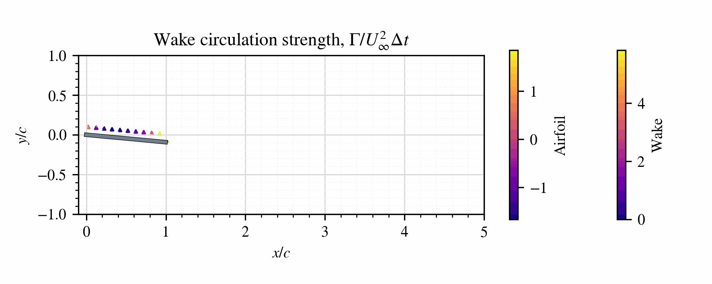
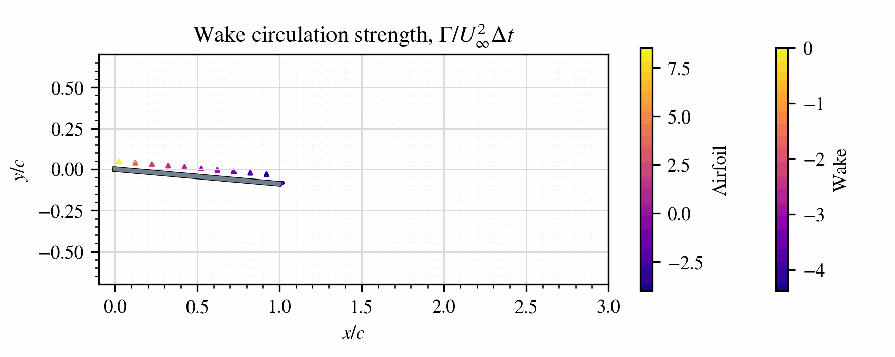
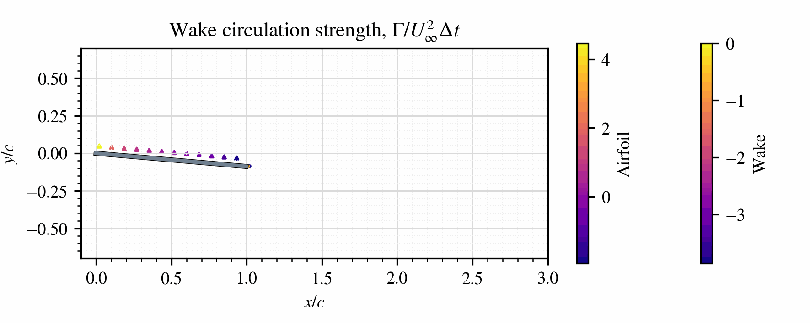
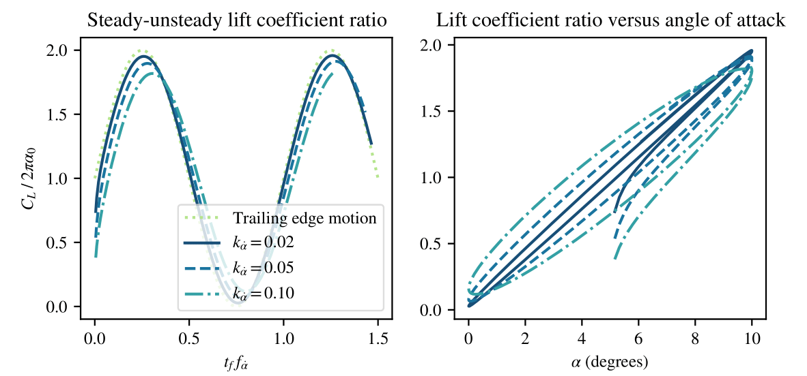

# Unsteady Lifting Panel Method

`Unsteady_Lifting_Panel_Method` is a Python library with solvers that let you easily model and simulate unsteady airfoil aerodynamics based on the vortex source/panel method.



Contents
========

 * [Installation](#installation)
 * [Usage](#usage)
 * [Output Structure](#output-structure)
 * [References](#References)


 ### Installation
---

The installation of the current project is very simple. If you have a clean Python installation, just type in your terminal the commands below.

```bash
$ git clone https://github.com/PRIDEmartins/Unsteady_Vortex_Source_Method.git
$ pip install numpy as np
$ pip install importlib 
$ pip install matplotlib.pyplot as plt
```

It is also highly recommended to install Anaconda or Miniconda:

<https://docs.conda.io/en/latest/miniconda.html>
<https://www.anaconda.com/>


### Usage
---

The Jupyter Notebook `./Examples.ipynb` contains a series of examples of how to use the current Python solver. The examples cover topics such as:

1. Wake-length independence analysis
2. Number of blade panels for the discretization of the airfoil
3. Time-step sizing independence analysis
4. Solution of steady flows: plot angle-of-attack vs. lift-coefficient to compare the current method against $2\pi$-curve

```haskell
ncases = 8

alpha0       = np.linspace(0.1, 20, num=ncases) * np.pi/180  ## initial angle of attacks, rad
npanels      = 10             ## number of blade panels
finalTime    = 2.5            ## total time of simulation, s
xVelocity    = -10            ## x-velocity of the airfoil, m/s
yVelocity    = 0.0            ## plunging velocity of the airfoil, m/s
rotFreq      = 0.0            ## rot. speed of the airfoil edge, Hz
rotAmplitude = 0.0            ## amplitude of rotational motion, m
plungAmpl    = 0.0            ## plunging amplitude, m
plungFreq    = 0.0            ## plunging frequency, Hz
nTimeSteps   = 10 * int( abs(finalTime*xVelocity) ) ## number of time steps 10, for steady cases

## Total circulation around the airfoil:
totalCirculation = np.zeros(len(alpha0))

for n in range(ncases):

      ## Below, we contruct and show the components of the panel system:
      myBladePanels, myTEVortex, myWakeVortexes  = constructBladePanels(alpha0[n], npanels, nTimeSteps) # construct the blade panels

      myWakeVortexes = np.empty(nTimeSteps-1, dtype=object) # constructWakeVortexes(nTimeSteps)

      ## Here, we define the motion of the LE of the airfoil:
      Time, timeStep, X, Y, U, V, Theta, Omega = LEmotion(nTimeSteps, finalTime, xVelocity, yVelocity, rotFreq, rotAmplitude, alpha0[n], plungAmpl, plungFreq)

      ## Updates circulation of myBladePanels, myTEVortex, myWakeVortexes
      ## returns: total circulation over airfoil at all time-steps
      solution = solveVortexPanels(timeStep, U, V, myBladePanels, Theta, myTEVortex, myWakeVortexes, saveToFile=False)

      totalCirculation[n] = solution[-1]


## Plot results # =============================

CL        = totalCirculation * np.cos(alpha0) / (0.5 * -U[-1]) # lift coeff.
alphaTheo = [0, 20]
clTheo    = [np.sin(0), 2*np.pi*np.deg2rad(20) ]
```

5. Simulation of a flat-plate plunging airfoil at different reduced plunging frequencies, $k$, such that $ k := 2 \pi f c / U_\infty $, where $f$ is the plunging motion frequency, $c$ is the flat-plate's chord length and $U_\infty$ is the reference velocity.



6. Simulation of a flat-plate pitching airfoil at different reduced pitching frequencies, $k$, such that $ k := 2 \pi f c / U_\infty $, where $f$ is the pitching motion frequency, $c$ is the flat-plate's chord length and $U_\infty$ is the reference velocity.


7. Simulation of a flat-plate airfoil suddenly put into steady forward motion at $t=0$




This solver also allows for easily plotting velocity, vorticity and pressure fields:


as well as force coefficients:



### References
---

 * Katz, Joseph, and Allen Plotkin. Low-speed aerodynamics. Vol. 13. Cambridge university press, 2001.
 * Anderson, John. EBOOK: Fundamentals of Aerodynamics (SI units). McGraw Hill, 2011.